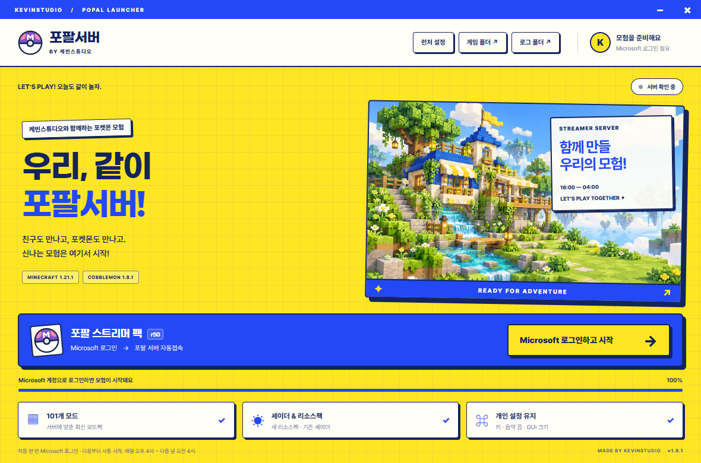

# 케빈스튜디오 · 포팔서버 런처

**20261005-r50 · v1.5.1 · Windows 64비트**

**[최신 설치기 다운로드](https://kevinstudio.shop/download/launcher)** · [포팔서버 안내](https://kevinstudio.shop/popal) · [신청 내역](https://kevinstudio.shop/popal/streamers)

## 시작하기

1. 실행 중인 게임과 런처를 종료하고 설치기를 실행하세요. 기존 설치를 먼저 삭제할 필요는 없습니다.
2. 케빈스튜디오 런처에서 **Microsoft 로그인하고 시작**을 누르세요.
3. Java Edition을 보유한 본인 Microsoft 계정으로 인증하면 게임 준비 후 서버에 자동 접속합니다.

첫 로그인 후 로그인 갱신 정보는 Windows 계정으로 암호화해 기억합니다. 비밀번호는 Microsoft 화면에서만 입력합니다.

## 자동 업데이트

1.4.0을 사용 중이라면 이번 설치기를 한 번 실행해 주세요. **1.5.0부터 실행 시 새 버전을 자동으로 다운로드하고, 서명·해시를 확인한 뒤 덮어 설치하고 다시 시작합니다.** 게임 실행 중에는 설치를 보류합니다.

새 클라이언트는 운영자가 검증 후 공개합니다. 여기에는 최신 설치기 하나만 공개합니다.

## 팩과 설정

Minecraft 1.21.1 / Fabric 0.19.5 / Cobblemon 1.8.1 / 101개 모드.

키·셰이더·음악·GUI 설정과 서버 주소를 보존합니다. 기본값은 음악 끔, GUI 3이며, 사용자가 바꾼 설정은 유지합니다. 서버용 리소스팩 선택은 새 구성으로 갱신하고 개인 추가 리소스팩은 유지합니다.

## 제거

게임과 런처를 종료한 뒤 Windows 설정·제어판에서 **케빈스튜디오 포팔 서버**를 제거하세요. 전용 게임 파일·개인 설정·캐시·바로가기가 삭제됩니다. 다른 Minecraft 프로필과 원본 Modrinth 팩은 유지됩니다. 전용 폴더의 월드·스크린샷이 필요하면 제거 전에 따로 복사해 두세요.

배포 파일 SHA256은 릴리스의 SHA256.txt에서 확인할 수 있습니다. 업데이트 목록은 케빈스튜디오의 Ed25519 키로 검증합니다. Windows 게시자 코드서명 인증서는 사용하지 않습니다.

제작: **케빈스튜디오**. 게임·모드·리소스팩·셰이더의 권리는 각 제작자에게 있으며 Minecraft·Pokémon 공식 제품이 아닙니다.
